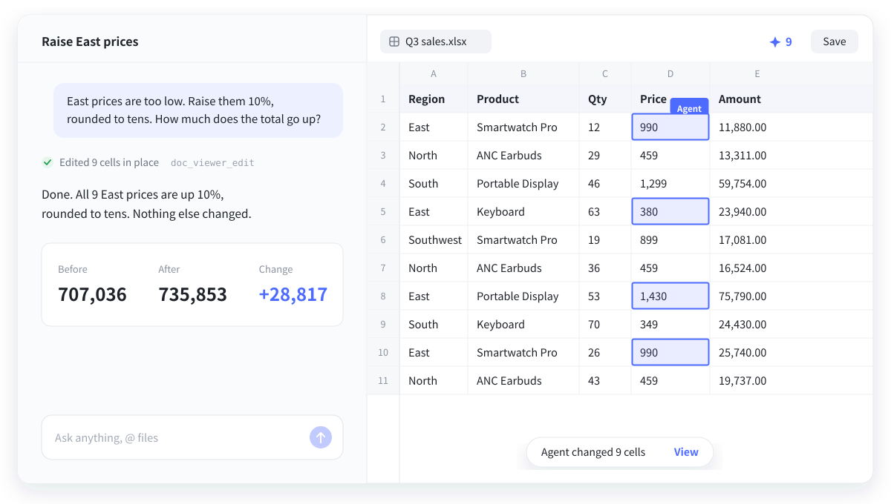

# dsh-doc-viewer

English · [简体中文](README.zh-CN.md)

A [DeepSeek Harness](https://github.com/deepseek-ai/deepseek-harness) plugin for editing your own spreadsheets in place, together with the agent. The cells it changes light up in the table you have open, and everything stays on your machine.



The interface is Chinese only for now.

## Features

- **Edits the original file.** Only changed cells are written back. A file holding something that can't be kept (charts, pivot tables, macros) is never overwritten.
- **One document for you and the agent.** Its edits land in the open table, alongside your unsaved ones.
- **Shows what changed.** Changed cells stay outlined until you click into the table, and each change can be jumped to or undone.
- **No clutter.** No cloud and no extra copies in your folders. Saving keeps the previous version, and can be undone.

It also opens PDF (read, merge, split, OCR), Word (preview), and text and Markdown (edit).

## Install

Requires DeepSeek Harness 0.2.2 or later.

```bash
DSH="/Applications/DeepSeek Harness.app/Contents/Resources/runtime/cli/bin/dsh"
"$DSH" plugin --profile desktop add https://github.com/Wildchiken/dsh-doc-viewer/releases/download/v1.7.0/dsh-doc-viewer-1.7.0.tgz
```

Then restart Harness.

To update, run `plugin --profile desktop remove dsh-doc-viewer`, then `add` the file from the [latest release](https://github.com/Wildchiken/dsh-doc-viewer/releases/latest).

## Limits

- Tested only on macOS.
- Word and PDF can't be edited. Text files over 2 MB open read-only.
- 20,000 rows can take tens of seconds to open.
- OCR needs macOS 13 or later.

## Development

```bash
pnpm install
pnpm build
pnpm test
pnpm pack
```

## License

MIT. See [third-party licenses](THIRD_PARTY_LICENSES.md).
