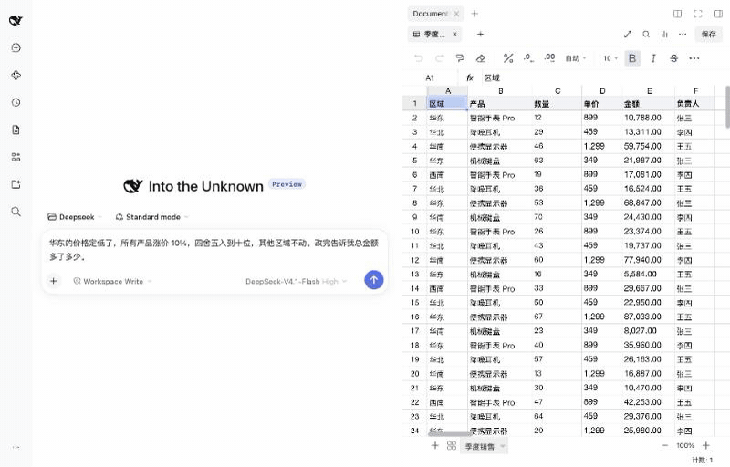

# dsh-doc-viewer

English · [简体中文](README.zh-CN.md)

A [DeepSeek Harness](https://github.com/deepseek-ai/deepseek-harness) plugin: **your own files, edited in place, by you and the agent together.** Open, edit and save spreadsheets, and read PDF, Word and text files, right inside Harness. Everything stays on your machine, and the cells the agent changes light up in the table you have open.



> The interface is in Chinese for now. English UI contributions are welcome.

## Why this one

Plenty of Harness plugins let an agent read and write office files. This one is about working on the same file together:

- **The original file, not a copy.** Saving writes only the cells that changed back into your workbook, so hyperlinks, named ranges, conditional formatting, images and comments stay as they were. If a file holds something it can't write back (charts, pivot tables, macros), it refuses to overwrite and asks you to save elsewhere.
- **You and the agent share one document.** The agent's edits land in the table you have open, without moving your view or selection. If you have unsaved edits, they are merged instead of overwritten, and saved together on your next ⌘S.
- **You can see what it did.** Changed cells get a labelled blue outline that stays until you click into the table or start typing (a minute at most), so it is still there after you read the agent's reply. "Agent changed N cells" lists each change, so you can jump to it or undo it.
- **Nothing leaves your machine, and no clutter.** No cloud service and no extra copies in your folders. Earlier versions are kept out of the way in `~/.dsh/doc-viewer/versions`.

## Install

Requires DeepSeek Harness 0.2.2 or later. Tested in the macOS desktop app and the web app.

**Easiest:** download `dsh-doc-viewer.tgz` from [the latest release](https://github.com/Wildchiken/dsh-doc-viewer/releases/latest), attach it in a Harness conversation, and say:

> Install this Harness plugin. If an older version is installed (the old package name is @local/doc-viewer), remove it first. Then confirm it loads in Harness.

**From the command line:**

```bash
DSH="/Applications/DeepSeek Harness.app/Contents/Resources/runtime/cli/bin/dsh"
"$DSH" plugin --profile desktop add https://github.com/Wildchiken/dsh-doc-viewer/releases/latest/download/dsh-doc-viewer.tgz
```

To update, run `"$DSH" plugin --profile desktop remove dsh-doc-viewer` first, then the same `add`. The first time, also add `"dsh-doc-viewer"` to `dsh.profile.bundles` in `~/.dsh/profiles/desktop/package.json` and restart Harness. If you used version 1.6 or earlier (named `@local/doc-viewer`), remove that package first and replace the old name in `bundles`.

## What it does

| Type | What you can do |
| --- | --- |
| Spreadsheets: xlsx, xls, csv, tsv, et | Edit, live formulas, cross-sheet references, merged cells, filters, find and replace, group statistics and charts, well-formatted PDF export |
| PDF | Continuous reading, thumbnails, selectable text, search; merge, split, delete pages, OCR (macOS Vision), convert to text, Word or Excel |
| Word: docx, doc, wps | Sandboxed preview, PDF export, text extraction |
| Text and Markdown | Edit and save in place, keeping the file's encoding (UTF-8, GB18030, UTF-16) and line endings; search; rendered Markdown preview and PDF export |

- **Default opener in Harness.** Spreadsheets open as editable tables from conversation links and the file tree. The preview's renderer menu switches back to the built-in viewer.
- **Beside the conversation.** The same document page can sit in the right sidebar; open tabs, unsaved edits and undo history move with it.
- **Safe saving.** ⌘S keeps the previous version and offers undo. Unsaved edits survive a restart, and changes made by other programs are detected.
- **Quick to open.** A workbook appears at once. Formula results the file doesn't hold are filled in from LibreOffice in the background.

## Agent tools

`doc_viewer_create`, `doc_viewer_context` (what the user is looking at, including sheet, selection and page), `doc_viewer_open`, `doc_viewer_read`, `doc_viewer_edit`, `doc_viewer_stats`, `doc_viewer_convert`, `doc_viewer_pdf`.

Without a `path`, reading, editing and statistics apply to the document the user has open, so "sum the selected column" is enough. `doc_viewer_edit` checks formulas before writing anything, queues calls per file so parallel calls can't overwrite each other, and reports each cell before and after along with the formula results that moved because of it. `doc_viewer_read` sizes its output from the current model's context window.

## Known limits

- Tested only on macOS. Linux and Windows have not been tried; reports are welcome.
- OCR uses macOS Vision and needs macOS 13 or later.
- Newer functions such as `XLOOKUP`, `FILTER` and `LET` are calculated by the LibreOffice bundled with Harness, so they may briefly show `#NAME?` after an edit. Above 200,000 cells there is no live calculation.
- Large workbooks take a while to open: expect tens of seconds at 20,000 rows on a busy machine.
- Word and PDF files can't be edited. Text files over 2 MB and files dragged in from Finder open read-only.

See the [Chinese README](README.zh-CN.md) for the full list.

## Development

```bash
pnpm install
pnpm build      # client.js and the lazily loaded client.viewer.js
pnpm test       # engine tests on real files; DSH_LIBREOFFICE_CLI=none simulates having no LibreOffice, as CI does
pnpm pack       # prepack builds the client and the OCR helper (needs Xcode command line tools)
```

## License

MIT. Third-party notices are in [NOTICE.md](NOTICE.md).
